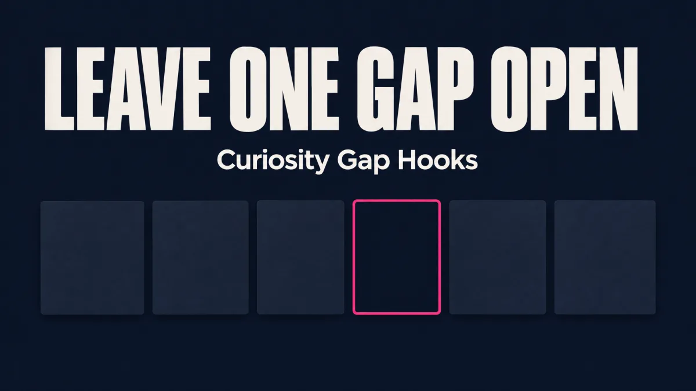

# Curiosity Gap Hooks

Write the first line of a LinkedIn post, email, article, video or ad so the reader has to
read the next one. The skill builds a hole the reader can point at, holds it open with
real evidence, then pays it off in the same shape.



## What it does

Ask for an opener and you get back:

- a payoff sentence, written first, so you can see the hole is real
- as many variants as you asked for (default 5), each with a different gap shape
- a 7-test score per variant
- one recommendation to pick from

It will not write a hook that promises something the body cannot deliver.

## Install

Claude Code, personal skills folder:

```bash
mkdir -p ~/.claude/skills/curiosity-gap-hooks
cp skills/curiosity-gap-hooks/SKILL.md ~/.claude/skills/curiosity-gap-hooks/SKILL.md
```

Claude Code, one project only:

```bash
mkdir -p .claude/skills/curiosity-gap-hooks
cp skills/curiosity-gap-hooks/SKILL.md .claude/skills/curiosity-gap-hooks/SKILL.md
```

Then restart Claude Code or start a new session so it picks up the skill.

## Use it

You do not have to type the skill name. Describe the problem in plain words:

- "My LinkedIn opener is flat. Here's the draft: ..."
- "Write 10 email subjects for this offer, curiosity gap style."
- "Give me 3 video cold opens for this case study."

To force it, name it: `/curiosity-gap-hooks write 5 openers for ...`

### Give it the three things it needs

1. **The format.** LinkedIn, email, article, video, ad, landing page or DM. The hold
   length depends on it.
2. **The reader.** What they already know and see every day. The gap has to be cut
   into ground they stand on.
3. **The true payoff.** One sentence: what the piece actually delivers. If you do not
   have one, the skill will ask for it. A hook without a payoff is a topic.

Example request:

> Format: LinkedIn. Reader: agency owners who run their own Google Ads. Payoff: the
> landing page answers two of the four questions buyers ask, and those two are the ones
> the ad platform already measures. Write 5 openers, different gap shapes.

### How to read the output

Each variant shows the gap shape, the opening lines exactly as they would ship, the hold,
the wrong guess it invites, the pay line, and the score. Check these before you post:

- Does the pay line deliver the shape the opener named? "The reason" pays with a reason.
- Is every number real? Anything unconfirmed is marked `[VERIFY: number]`. Replace it
  or cut it. Do not ship it.
- Would the reader say what is missing in five words? If not, the gap is too vague.

## When not to use it

- The piece has no payoff yet. Write the answer first, then the hook.
- You want a story hook built from a person, place and cost. That is a story skill.
- You want a full video script with retention beats. That is a script skill.

## Good and bad examples

See [EXAMPLES.md](EXAMPLES.md) for side-by-side bad and good openers, each BAD line
naming the test it fails.

## Source

Built from curiosity research: information-gap theory, the wrong-guess retention study,
the Pandora shock-pen study, and the curiosity-dampening study. Original idea from The
Rest Is Science podcast episode on curiosity.
