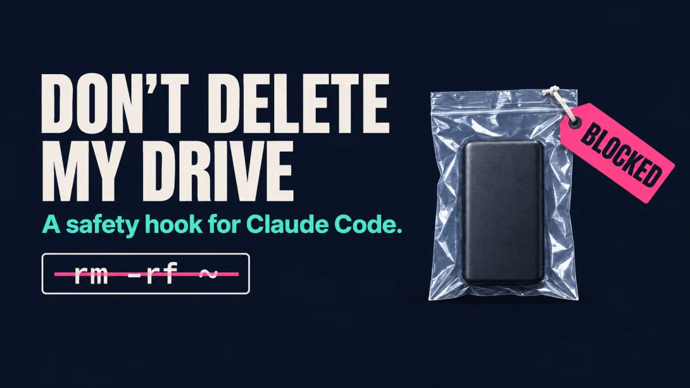

# Don't delete my drive



A safety hook for [Claude Code](https://claude.com/claude-code). It reads every shell command before it runs and refuses the ones that would wipe your disk, your home folder, your project, an external drive or your backups.

Source, full docs and tests: https://github.com/GitDomHub/dont-delete-my-drive (MIT)

## Who it is for

Anyone who lets Claude Code run shell commands, especially with permission prompts off or auto mode on. It works on macOS and Linux and needs Python 3.6 or newer.

## Install

```bash
curl -fsSL https://raw.githubusercontent.com/GitDomHub/dont-delete-my-drive/main/install.sh | bash
```

Start a new Claude Code session afterwards so it loads the hook.

If you would rather read before you run, clone the repo, open `install.sh` (it is short), then run `./install.sh`. The installer copies one Python file to `~/.claude/hooks/`, backs up `~/.claude/settings.json`, and adds the hook plus a few permission rules.

## What happens to a command

Every command ends one of three ways.

| Command | What happens | Why |
|---|---|---|
| `rm -rf ~` | **Blocked** | It deletes your home folder. |
| `rm -rf ~/Documents` | **Blocked** | One of the folders that hold your life. |
| `find ~ -delete` | **Blocked** | Same result, different command. |
| `rm -rf some-existing-folder` | **Asks you first** | Unless it is a temp or build folder, or every file in it is committed in git. |
| `git reset --hard` | **Asks you first** | It throws away uncommitted work. |
| `rm file.txt` | Runs | One file. |
| `rm -rf node_modules` | Runs | A build folder you can regenerate. |
| `git push` | Runs | Nothing is deleted. |

When a command is blocked, Claude is told to stop and ask you to run the step yourself in a terminal. It is told not to retry, rephrase or script around the block.

## When it blocks something

Read the message. If the step really is needed, run it yourself in a terminal. Do not ask Claude to find another way around it.

## More

The repo covers the other two layers (permission rules and auto mode rules), the optional config file for your own protected folders, and the test suite.
