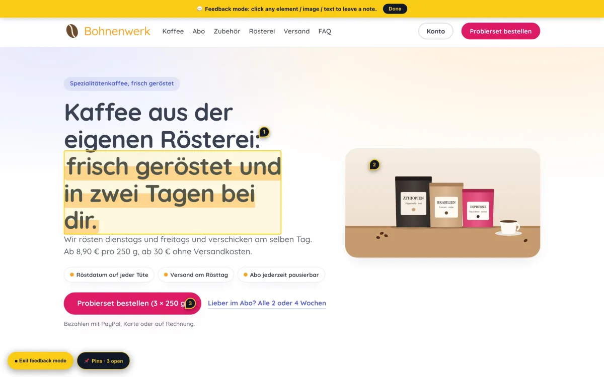

# PinPoint



Visual feedback for any web page. Drop one script tag onto a site and reviewers can click anywhere on the page to leave a comment pinned to that exact element: text, image, button or block. Others can reply, mark items done, and edit their own text. Nothing can be deleted, so feedback is never lost.

Source, full docs and demo: https://github.com/GitDomHub/pinpoint-feedback (MIT)

## Who it is for

Anyone who sends web pages out for review: designers, agencies, freelancers, anyone building a site for a client. It replaces "can you move the thing near the top" with a pin on the thing.

## What you need

A free Cloudflare account and the Wrangler command line tool. Setup takes about 5 minutes. There is no framework and no build step: one small JavaScript file on the page, one Cloudflare Worker and one D1 database behind it.

## Set up

1. Create the database: `wrangler d1 create pinpoint-feedback`, then paste the `database_id` it prints into `wrangler.toml`.
2. Create the table: `wrangler d1 execute pinpoint-feedback --remote --file schema.sql`.
3. Deploy the Worker: `wrangler deploy`. It prints your Worker URL.
4. Add one tag before `</body>`, with `data-api` pointing at your Worker URL:

```html
<script src="https://cdn.jsdelivr.net/gh/GitDomHub/pinpoint-feedback@main/pinpoint.js" data-api="https://pinpoint-feedback.YOURNAME.workers.dev"></script>
```

A "Give feedback" button appears bottom-left on every page. The repo README has the full steps and the exact commands.

## How a reviewer uses it

1. Click **Give feedback**. The page enters feedback mode.
2. Hover over the page. The element under the cursor is outlined. Click it.
3. Type a name and a note, then **Add pin**.
4. Click any pin to read the thread, reply, mark it done, or edit a message.

Pins stick to the right element even when the layout shifts, and they follow it on a phone.

## Show what changed

After a round of pins has been applied, `changes.js` puts a badge on every edited element. Click a badge to see what it said before and what it says now. A toggle bottom-right hides all markers so the page can be read clean.

## Before you use it for a client

Pins are shared by everyone who opens the page. By default the Worker accepts requests from any site. The optional `ALLOWED_ORIGINS` setting locks it to named sites. Set it for anything that is not a throwaway review.
